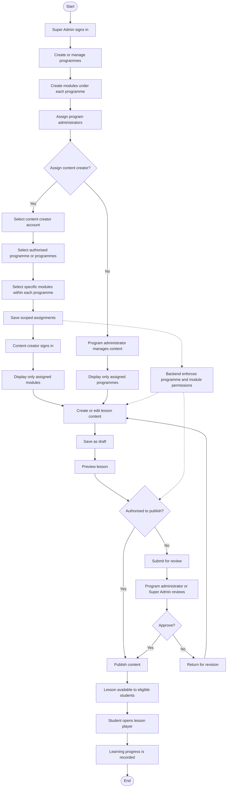

# Access control

Three staff roles manage content. Scope is stored as assignment rows, not inferred from the role name. FastAPI checks every content operation against the signed-in user’s assignments. The Next.js UI filters lists to match, but hiding a link is not enough.

## Roles

| Role | Scope of access | Content permissions |
| --- | --- | --- |
| Super administrator | All programmes, modules, users, and content | Create, edit, review, publish; assign program administrators and content creators |
| Program administrator | One or more assigned programmes | Manage every module and lesson in those programmes; assign content creators only inside that scope |
| Content creator | Only explicitly assigned programme–module combinations | Create and edit lessons, slides, examples, and questions for those modules; submit for review; cannot manage other modules or programmes; cannot publish |
| Student | Enrolled or authorised learning content | View published lessons, complete activities, and track personal progress |

A person can hold the **content creator** role and several scoped assignments without becoming a program administrator. Assignments are a separate entity from the role.

A **content creator assignment always includes both the programme and the module**. Granting a module name alone is ambiguous when the same code exists in more than one programme.

Empty program-administrator assignments grant nothing. They do not fall back to system-wide access.

## How assignments should work



### Example

Suppose the platform has Bachelor of Science in Computing and Business & Management. The Super Admin configures:

| User | Programme | Assigned module | Access |
| --- | --- | --- | --- |
| Admin A | Computing | All modules | Program administration |
| Admin B | Business & Management | All modules | Program administration |
| Creator C | Computing | Database Management Systems | Content creation |
| Creator C | Business & Management | Networking | Content creation |
| Creator D | Computing | Operating Systems | Content creation |

Creator C sees only those two programme–module combinations. Creator D sees only Operating Systems under Computing. Neither can edit another module by changing a URL.

## How accounts are created

`POST /api/auth/signup` always creates a **student**. It cannot create a super administrator, program administrator, or content creator.

Super Admin assigns `administrator` and `creator` to accounts that already exist. Those assignment screens cannot grant `super_administrator`.

The local demo accounts, including `super@examsprep.local`, are inserted only when `SEED_DEMO_USERS=true`. Production leaves that flag `false`.

The real super administrator is created once, from the API service, either by `SUPER_ADMIN_NAME`, `SUPER_ADMIN_EMAIL`, and `SUPER_ADMIN_PASSWORD` at startup or by `python -m app.create_super_admin`. Both refuse the demo email, the demo password, an email that already exists, and a second super administrator. Steps: [deployment.md](../operations/deployment.md).

Seeded local demo (password `examsready`):

| Email | Role | Seeded scope |
| --- | --- | --- |
| `super@examsprep.local` | Super administrator | Entire catalogue |
| `admin@examsprep.local` | Program administrator | Bachelor of Science in Computing (all modules) |
| `creator@examsprep.local` | Content creator | Computing · IT212 Database Management Systems and IT213 Networking |
| `student@examsprep.local` | Student | Published Computing Year 2 Semester 1 modules |

## Rules the API must keep

1. **Assignment management.** Super Admin assigns administrators to programmes and creators to individual programme–module combinations. Program administrators assign creators only inside their programmes.
2. **Programme scope.** A program administrator cannot grant permissions outside assigned programmes.
3. **Module scope.** A content creator can access only explicitly assigned modules within their assigned programmes.
4. **Automatic filtering.** The dashboard, module selector, lesson list, and search results show only authorised content.
5. **Server-side enforcement.** Every create, read, update, delete, preview, and publish operation checks authorisation in FastAPI.
6. **No URL bypass.** Guessing another lesson ID or changing a route must not grant access. Staff receive 403; students receive 404 for unpublished or unauthorised lessons.
7. **Safe reassignment.** Removing an assignment revokes future access and does not delete previously created content.
8. **Audit trail.** Record who created, edited, published, assigned, or revoked access.
9. **Programme-specific content.** Lessons and chapters belong to a module that sits under a programme (via semester and academic year), not to a global module name.
10. **Student visibility.** Students see only published content they are authorised to access.

## Content workflow

Creators: save draft → preview → **submit for review**.

Program administrators and Super Admins, within scope: review (approve publishes, reject returns `CHANGES_REQUESTED`) or publish/unpublish directly.

```
DRAFT → IN_REVIEW → CHANGES_REQUESTED or PUBLISHED
PUBLISHED → UNPUBLISHED / ARCHIVED
```

Clients cannot set `"status": "PUBLISHED"` on a write. Publish and review are dedicated endpoints that check `can_publish`.

## Where it lives in code

| Concern | Location |
| --- | --- |
| Assignment tables | `api/app/models/access.py` |
| Scope loading and `require_module` / `require_programme` | `api/app/access.py` |
| Admin CMS and assignment endpoints | `api/app/routers/admin.py` |
| Student/preview visibility | `api/app/routers/learn.py` |
| Migration | `api/alembic/versions/20261021_0006_content_assignments.py` |
| Demo users and seed assignments | `api/app/seed.py` |
| One-time production super administrator | `api/app/create_super_admin.py` |
| Staff UI: Assignments, filtered nav, submit vs publish | `app/src/app/admin/` |
