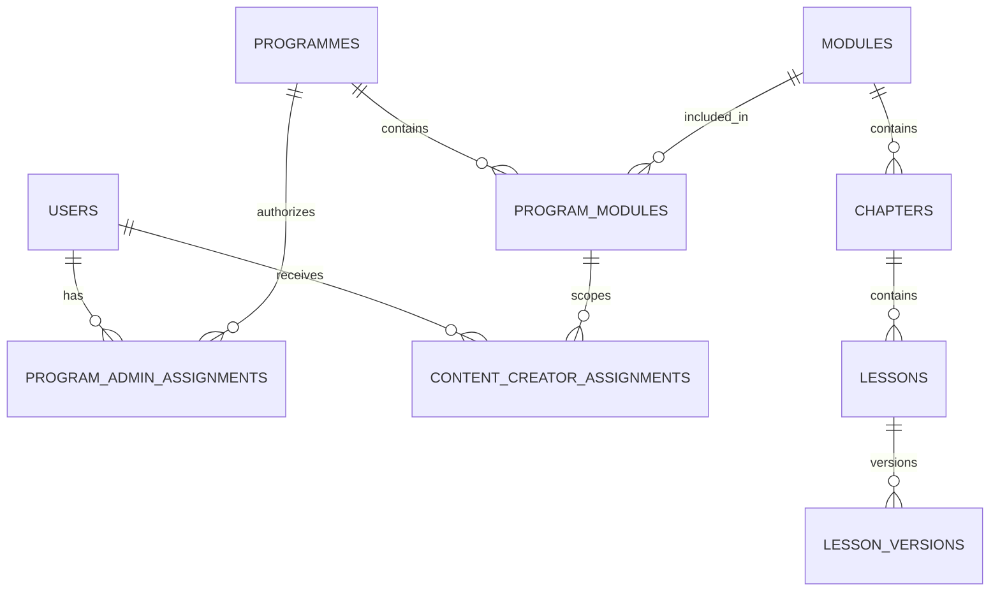

# Database design

SQLAlchemy models and Alembic revisions live in `api/`. Marketing catalogue copy still also exists in `app/src/data/programmes.ts` until those pages read FastAPI. Seed Computing, roles, and demo assignments with `python -m app.seed` after `alembic upgrade head`.

Assignment and enforcement rules: [access-control.md](../architecture/access-control.md).

## Hierarchy

```
users ── user_roles ── roles
users ── program_admin_assignments ── programmes
programmes ── program_modules ── modules
users ── content_creator_assignments ── program_modules
programme
  academic_year
    semester
      module
        chapter
          lesson ── lesson_versions ── content_reviews
        quiz ── quiz_questions ── questions ── question_versions
        topic
          resource
enrolment / attempt / progress / bookmark   (student learning)
audit_logs
```



## Identity and access

**users** — `id`, `name`, `email` (unique), `password_hash`, `status`, timestamps.

**roles** — `student` | `creator` | `administrator` | `super_administrator`. The `administrator` role is a **program administrator**: it does not imply system-wide access.

**user_roles** — a person may hold more than one role when authorised. The content-creator **role** is separate from creator **assignments**.

**program_modules** — `programme_id`, `module_id` (unique together). Names a module’s inclusion in a particular programme. Modules still sit under semester → academic year → programme; this join exists so creator grants can target that pair, including when the same code later exists in two programmes.

**program_admin_assignments** — `user_id`, `programme_id` (unique together), `assigned_by_id`. Grants program-administrator access to every module in that programme. Removing a row revokes future access and does not cascade-delete lessons.

**content_creator_assignments** — `user_id`, `program_module_id` (unique together), `assigned_by_id`. Grants content-creation access to that exact programme–module combination.

Do not rely on frontend filtering. FastAPI loads `AccessScope` from these tables and checks every CMS and learn operation. Super administrators skip the assignment tables and see everything. A program administrator with no assignment rows sees nothing.

Administrators must not receive blanket access to every student’s private fields. Scope student lists to assigned programmes.

## Academic catalogue (first migration)

**programme** — `id`, `slug`, `name`, `category`, `status` (`available` \| `coming_soon` \| `preview`), `duration_years`, `blurb`, timestamps.

**academic_year** — `id`, `programme_id` (FK), `year_number` (1–4).

**semester** — `id`, `academic_year_id` (FK), `semester_number` (1–2).

**module** — `id`, `semester_id` (FK), `code` (e.g. IT212), `name`, `credits` (nullable until confirmed). Codes are unique **per programme**, not globally, so the same code can exist in another programme later.

**chapter** — `id`, `module_id` (FK), `title`, `position`, `status`. Lessons belong to a chapter inside a module, which already belongs to a programme.

Unique: programme `slug`; `program_modules (programme_id, module_id)`; module `code` unique per programme on create.

## Versioned learning content

**lessons** — identity and placement: `module_id`, `creator_id`, `title`, `status`, `published_version_id` (nullable FK to `lesson_versions`).

**lesson_versions** — immutable snapshot once submitted: body, attachments, `version_number`, author, checksum, created_at. Draft rows may still be edited; submitted/published rows are not silently rewritten.

**content_reviews** — `version_id`, reviewer, decision (`approve` \| `reject` \| `request_changes`), feedback, timestamps. History is appended, not overwritten.

**questions**, **question_versions**, **quizzes**, **quiz_questions** — same versioning for stems, keys, explanations, and scoring rules so a later edit cannot rewrite a completed attempt.

Overall lesson status and version status are separate. Example: lesson published at version 3 while version 4 is `IN_REVIEW`. Students still see version 3.

Allowed transitions (validated in FastAPI, not by writing a status column from the client):

| From | To |
| --- | --- |
| `DRAFT` | `IN_REVIEW` (creator submit) or `PUBLISHED` (admin publish within scope) |
| `IN_REVIEW` | `CHANGES_REQUESTED` (reject) or `PUBLISHED` (approve) |
| `CHANGES_REQUESTED` | `IN_REVIEW` (resubmit) |
| `PUBLISHED` | `UNPUBLISHED` |
| any retired path | `ARCHIVED` |

## Student learning (after the review workflow)

`enrolment`, `attempt` (stores the question-version ids used), `progress`, `bookmark`.

## Audit

**audit_logs** — actor, action, resource type/id, version id, payload, timestamp. Required for submit, approve, reject, publish, unpublish, assignments, role changes, and suspensions. Super administrators cannot bypass this.

## Seed (Computing)

Seed BSc Computing as `available`. Seed Year 2 Semester 1:

| Code | Name |
| --- | --- |
| IT211 | Systems Analysis and Design |
| IT212 | Database Management Systems |
| IT213 | Networking and Data Communication I |
| IT214 | Operating Systems |
| IT215 | Discrete Mathematics |

Other years/semesters: rows can exist with no modules until the official list is confirmed. The listed **1,290 credits** is from the supplied programme sheet — confirm meaning (programme credits vs contact hours) before storing it as a constraint.

## Backup

When PostgreSQL is live on Railway: use the provider’s managed backups, keep credentials out of Git, run schema changes through Alembic, and test a restore before storing real student records. Record the runbook in `docs/operations/` at that time.
